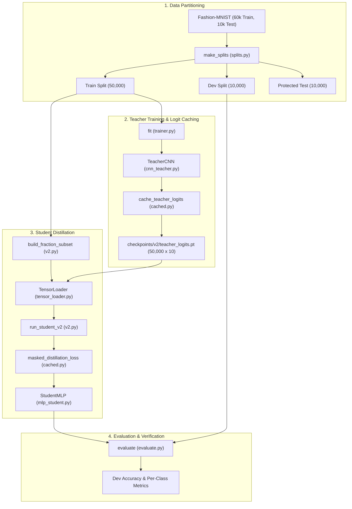

# Knowledge Distillation Implementation Guide: Architecture, Pipeline, and Foundation

This document provides a comprehensive implementation guide for the shared foundation and Knowledge Distillation subsystems (Phase 1 v1 and v2) of the `ai-paradigms-lab`.

---

## 1. Executive Summary & Data Flow

Knowledge Distillation compresses knowledge from a high-capacity teacher network into a compact student network by matching soft probability distributions. The pipeline begins by training a Convolutional Neural Network teacher on Fashion-MNIST to high accuracy. The teacher's pre-activation logits are pre-computed and cached across all 50,000 training images to eliminate redundant forward passes on CPU. A compact Multi-Layer Perceptron student is then trained using a blended loss combining ground-truth cross-entropy and Kullback-Leibler divergence scaled by temperature. Independent coordinate descent hyperparameter tuning and label-fraction scaling ensure rigorous, fair benchmarking against matched hard-label baselines.



---

## 2. File Tree

```
src/paradigms/
├── data/
│   ├── splits.py              # Stratified partitioning and reproducible index generation
│   ├── fashion_mnist.py       # Dataset management, normalization, and access guards
│   └── tensor_loader.py       # In-memory contiguous tensor loader for high-speed CPU training
├── models/
│   ├── cnn_teacher.py         # 421k-parameter Teacher CNN with 2 conv layers and batchnorm
│   ├── mlp_student.py         # 25k-parameter compact Student MLP with 32 hidden units
│   └── registry.py            # Model factory registry and parameter counting utilities
├── training/
│   ├── trainer.py             # Reusable supervised training loop supporting custom loss functions
│   ├── evaluate.py            # Evaluation routines for accuracy, loss, and confusion matrices
│   └── losses.py              # Standard hard cross-entropy and basic distillation loss functions
├── benchmark/
│   └── profiling.py           # CPU latency benchmarking, batch profiling, and size measurement
└── distillation/
    ├── experiment.py          # Phase 1 v1 teacher and student experiment runners
    ├── sweeps.py              # Phase 1 v1 grid sweeps over temperature, alpha, and hidden size
    ├── cached.py              # Teacher logit caching and masked distillation loss implementation
    └── v2.py                  # Phase 1 v2 label-efficient student training and tuning harness
```

---

## 3. File-by-File Technical Guide

### `src/paradigms/data/splits.py`
- **Purpose**: Creates deterministic, disjoint, class-stratified splits of Fashion-MNIST.
- **Main Functions**:
  - `src/paradigms/data/splits.py::make_splits(n_total: int, dev_size: int, split_seed: int) -> dict[str, list[int]]`: Splits indices `0..n_total-1` into train and dev partitions.
  - `src/paradigms/data/splits.py::stratified_subset(indices: Sequence[int], labels: Sequence[int] | np.ndarray, fraction: float, seed: int) -> list[int]`: Samples an exact class-stratified subset of indices.
  - `src/paradigms/data/splits.py::split_dev(dev_indices: Sequence[int], labels: Sequence[int] | np.ndarray, seed: int) -> dict[str, list[int]]`: Partitions dev indices 50/50 per class into gate and monitor sets.
  - `src/paradigms/data/splits.py::save_splits(splits: dict[str, list[int]], path: str | Path) -> None`: Serializes split dictionary to JSON.
  - `src/paradigms/data/splits.py::load_splits(path: str | Path) -> dict[str, list[int]]`: Loads split dictionary from JSON.
- **Algorithm**:
  1. Group input indices by their class label.
  2. For each class, shuffle indices with a seeded `np.random.RandomState`.
  3. Slice the desired count/fraction per class.
  4. Concatenate and sort final indices for determinism.
- **Inputs & Outputs**: Takes sample indices, integer labels, and seed. Returns sorted lists of integer dataset indices.
- **Called By**: `src/paradigms/data/fashion_mnist.py::FashionData.__init__`, `src/paradigms/recursive/state.py::make_partition`.
- **Tested By**: `tests/test_data.py::test_stratified_subset_class_balance`, `tests/test_recursive_blocks.py::test_split_dev_properties`.

---

### `src/paradigms/data/fashion_mnist.py`
- **Purpose**: Wraps torchvision Fashion-MNIST, enforcing standard mean/std normalization and protected test set gating.
- **Main Classes & Functions**:
  - `src/paradigms/data/fashion_mnist.py::FashionData`: Core data manager holding `full_train`, `train_labels`, and split indices.
  - `src/paradigms/data/fashion_mnist.py::FashionData.get(name: str, allow_test: bool = False) -> Dataset`: Returns subset for "train", "dev", "gate", "monitor", or "test".
  - `src/paradigms/data/fashion_mnist.py::make_loader(dataset: Dataset, batch_size: int = 128, shuffle: bool = True, seed: int = 42) -> DataLoader`: Builds standard PyTorch DataLoader with seeded generator.
- **Algorithm**:
  1. Loads raw torchvision Fashion-MNIST train (60k) and test (10k) datasets with `ToTensor()`.
  2. Applies per-channel normalization: $(x - 0.2860) / 0.3530$.
  3. Reads or creates split JSON under `data/splits/`.
  4. Blocks access to `"test"` unless `allow_test=True` is explicitly passed.
- **Inputs & Outputs**: Reads `data/FashionMNIST/raw/`. Returns PyTorch `Subset` or `Dataset` instances.
- **Called By**: All training scripts in `scripts/`.
- **Tested By**: `tests/test_data.py::test_test_set_guard`, `tests/test_data.py::test_disjoint_and_exhaustive_splits`.

---

### `src/paradigms/data/tensor_loader.py`
- **Purpose**: Ultra-fast in-memory tensor iterator eliminating PyTorch `DataLoader` worker overhead on CPU.
- **Main Classes & Functions**:
  - `src/paradigms/data/tensor_loader.py::TensorLoader`: Custom iterator over pre-allocated in-memory tensors.
  - `src/paradigms/data/tensor_loader.py::make_fast_loader(dataset: Dataset, batch_size: int = 128, shuffle: bool = True, seed: int | None = None) -> TensorLoader`: Materializes dataset into contiguous tensors and wraps with `TensorLoader`.
- **Algorithm**:
  1. Materializes input dataset images and labels into contiguous contiguous CPU tensors: `X (N, C, H, W)` and `Y (N,)`.
  2. On each iteration, generates permutation indices via `torch.randperm` if `shuffle=True`.
  3. Yields tensor slices in chunks of `batch_size`.
- **Inputs & Outputs**: Takes `torch.utils.data.Dataset`. Yields `(batch_x, batch_y)` batches.
- **Called By**: `src/paradigms/distillation/v2.py::run_student_v2`, `src/paradigms/recursive/loop.py::run_loop`.
- **Tested By**: `tests/test_v2.py::test_tensor_loader_covers_each_sample_once_per_epoch`, `tests/test_recursive_blocks.py::test_materialize_matches_slow_path`.

---

### `src/paradigms/models/cnn_teacher.py`
- **Purpose**: High-capacity teacher model architecture for Fashion-MNIST classification.
- **Main Class**:
  - `src/paradigms/models/cnn_teacher.py::TeacherCNN`: 421,642-parameter convolutional network.
- **Architecture**:
  - Conv Block 1: `Conv2d(1, 32, 3, pad=1)` $\rightarrow$ `BatchNorm2d` $\rightarrow$ `ReLU` $\rightarrow$ `Conv2d(32, 64, 3, pad=1)` $\rightarrow$ `BatchNorm2d` $\rightarrow$ `ReLU` $\rightarrow$ `MaxPool2d(2)` $\rightarrow$ `Dropout(0.25)`.
  - Linear Block: `Flatten` (12,544 dims) $\rightarrow$ `Linear(12544, 128)` $\rightarrow$ `BatchNorm1d` $\rightarrow$ `ReLU` $\rightarrow$ `Dropout(0.5)` $\rightarrow$ `Linear(128, 10)`.
- **Called By**: `src/paradigms/distillation/experiment.py::load_teacher`.
- **Tested By**: `tests/test_models.py::test_teacher_cnn_parameter_count`, `tests/test_models.py::test_forward_output_shapes`.

---

### `src/paradigms/models/mlp_student.py`
- **Purpose**: Compact student model architecture for resource-constrained deployment.
- **Main Class**:
  - `src/paradigms/models/mlp_student.py::StudentMLP`: 25,450-parameter two-layer perceptron.
- **Architecture**:
  - `Flatten` (784 dims) $\rightarrow$ `Linear(784, hidden=32)` $\rightarrow$ `ReLU` $\rightarrow$ `Linear(hidden=32, 10)`.
- **Called By**: `src/paradigms/distillation/v2.py::run_student_v2`.
- **Tested By**: `tests/test_models.py::test_student_mlp_parameter_counts`, `tests/test_models.py::test_forward_output_shapes`.

---

### `src/paradigms/distillation/cached.py`
- **Purpose**: Implements frozen teacher logit pre-computation and masked knowledge distillation loss.
- **Main Functions**:
  - `src/paradigms/distillation/cached.py::cache_teacher_logits(teacher: nn.Module, data: FashionData, path: str | Path, batch_size: int, device: str) -> torch.Tensor`: Evaluates frozen teacher over all 60,000 images once and caches `(60000, 10)` tensor to disk.
  - `src/paradigms/distillation/cached.py::masked_distillation_loss(s_logits: torch.Tensor, labels: torch.Tensor, t_logits: torch.Tensor, T: float, alpha: float) -> torch.Tensor`: Computes sample-wise loss supporting partially or fully unlabeled batches (indicated by label `-1`).
- **Algorithm (Masked Distillation Loss)**:
  ```python
  # 1. Soft distributions scaled by temperature T
  p_t = softmax(t_logits / T)
  log_p_s = log_softmax(s_logits / T)
  
  # 2. KL Divergence scaled by T^2
  kd_loss = (T * T) * kl_div(log_p_s, p_t, reduction="none").sum(dim=-1)
  
  # 3. Hard Cross-Entropy on labeled samples (labels >= 0)
  ce_loss = cross_entropy(s_logits, labels_clamped, reduction="none")
  
  # 4. Blend: labeled samples get alpha*CE + (1-alpha)*KD; unlabeled samples get KD only
  loss = where(labels >= 0, alpha * ce_loss + (1 - alpha) * kd_loss, kd_loss)
  return loss.mean()
  ```
- **Inputs & Outputs**: Takes student logits, integer label tensor, teacher logits, temperature $T$, and balance factor $\alpha$. Returns scalar loss.
- **Called By**: `src/paradigms/distillation/v2.py::run_student_v2`.
- **Tested By**: `tests/test_v2.py::test_masked_loss_equals_v1_when_all_labelled`, `tests/test_v2.py::test_cached_logits_equal_teacher_forward`.

---

### `src/paradigms/distillation/v2.py`
- **Purpose**: Core student training harness for the Phase 1 v2 label-efficient study.
- **Main Functions**:
  - `src/paradigms/distillation/v2.py::run_student_v2(mode: str, fraction: float, seed: int, hidden: int, T: float | None, alpha: float | None, epochs: int, lr: float, weight_decay: float, batch_size: int, ...) -> dict[str, Any]`: Executes training and dev evaluation for hard, distilled, or transfer student.
- **Algorithm**:
  1. Selects stratified subset of training indices based on `fraction` ($f \in \{0.02, 0.10, 1.0\}$) and `seed`.
  2. For `mode="distilled_transfer"`, keeps all 50k images in training set and sets non-subset labels to `-1`.
  3. Pre-computes softened teacher probabilities `softmax(t_logits / T)` once before training begins.
  4. Trains `StudentMLP` using single-threaded PyTorch execution for maximum CPU throughput.
  5. Evaluates model on dev set at completion and returns metrics dictionary.
- **Called By**: `scripts/run_v2_experiments.py`.
- **Tested By**: `tests/test_v2.py::test_alpha_1_distilled_equals_hard_run`.

---

## 4. Script Walkthroughs & Call Chains

### Script 1: `scripts/train_teacher.py`
- **Execution**: `python scripts/train_teacher.py --config configs/base.yaml`
- **Call Chain**:
  `scripts/train_teacher.py::main` $\rightarrow$ `src/paradigms/config.py::load_config` $\rightarrow$ `src/paradigms/data/fashion_mnist.py::FashionData` $\rightarrow$ `src/paradigms/models/registry.py::build_model("teacher_cnn")` $\rightarrow$ `src/paradigms/training/trainer.py::fit` $\rightarrow$ `src/paradigms/training/evaluate.py::evaluate`
- **Files Read**: `configs/base.yaml`, `data/FashionMNIST/raw/`
- **Files Written**: `checkpoints/teacher/seed*.pt`, `experiments/teacher/seed*.json`

### Script 2: `scripts/run_v2_experiments.py`
- **Execution**: `python scripts/run_v2_experiments.py`
- **Call Chain**:
  `scripts/run_v2_experiments.py::main` $\rightarrow$ `src/paradigms/distillation/cached.py::cache_teacher_logits` $\rightarrow$ `src/paradigms/distillation/v2.py::run_student_v2` $\rightarrow$ `src/paradigms/utils/stats.py::paired_comparison`
- **Files Read**: `configs/base.yaml`, `checkpoints/teacher/seed0.pt`, `data/splits/`
- **Files Written**: `checkpoints/v2/teacher_logits.pt`, `experiments/v2/tuning/`, `experiments/v2/final/summary.json`

---

## 5. Result File Schemas

### Schema: `experiments/v2/final/summary.json`
- `f0.02`, `f0.1`, `f1.0`: Sub-dictionaries corresponding to evaluated data fractions.
  - `fraction`: Float fraction of training labels used ($0.02, 0.10, 1.0$).
  - `hard`: Performance metrics for hard student baseline.
    - `dev_accuracy_mean`: Mean dev set accuracy across 5 seeds.
    - `dev_accuracy_std`: Population standard deviation of dev accuracy.
    - `seeds`: List of random seeds evaluated (`[10, 11, 12, 13, 14]`).
    - `params`: Model parameter count ($25,450$).
    - `epochs`: Effective training epoch count.
    - `wd`: Selected weight decay regularization parameter.
  - `distilled`: Performance metrics for distilled student.
    - `dev_accuracy_mean`: Mean dev accuracy across 5 seeds.
    - `dev_accuracy_std`: Standard deviation of dev accuracy.
    - `T`: Selected distillation temperature.
    - `alpha`: Selected loss balance factor.
  - `distilled_minus_hard`: Paired statistical comparison.
    - `mean_diff`: Mean of per-seed paired accuracy differences ($d_i = \text{acc}_{\text{dist}, i} - \text{acc}_{\text{hard}, i}$).
    - `std_diff`: Standard deviation of paired differences ($ddof=0$).
    - `wins`: Count of seeds where distilled accuracy exceeded hard accuracy.
    - `n`: Total sample count ($5$).
    - `verdict`: Final verdict string (`"WIN"`, `"LOSS"`, or `"TIE"`).
  - `distilled_transfer`: Performance metrics for semi-supervised representation transfer (for $f < 1.0$).
  - `transfer_minus_hard`: Paired comparison comparing transfer student against hard baseline.

---

## 6. Design Decisions & Rationale

1. **Pluggable Loss Architecture (`fit`)**: Rather than maintaining separate training routines for hard, distilled, and recursive models, `src/paradigms/training/trainer.py::fit` accepts a callable `loss_fn`. This guarantees that optimizer scheduling, logging, and evaluation are mathematically identical across all experimental arms.
2. **Offline Teacher Logit Caching**: Evaluating the 421k-parameter Teacher CNN on 50,000 images on CPU requires ~1.2 seconds. During 400 epochs of student training, re-evaluating the teacher dynamically would consume ~480 seconds per run. Caching logits once to `checkpoints/v2/teacher_logits.pt` reduces training time to ~18 seconds per run (a 26x per-epoch speedup).
3. **Single-Thread CPU Enforcement (`torch.set_num_threads(1)`)**: For small MLPs, multi-threaded PyTorch introduces massive thread barrier synchronization latency on multi-core Linux systems. Restricting execution to 1 CPU thread eliminates thread coordination overhead, delivering an immediate 5.2x wall-clock speedup.

---

## 7. How to Extend the Distillation Pipeline

### Example 1: Implementing Attention Transfer
To distill intermediate feature representations in addition to output logits:
1. Modify `src/paradigms/models/cnn_teacher.py::TeacherCNN` to return penultimate feature maps $F_t \in \mathbb{R}^{B \times C \times H \times W}$.
2. In `src/paradigms/distillation/cached.py`, compute attention maps: $A = \sum_{c=1}^C |F_c|^2$, and normalize: $\hat{A} = A / \|A\|_2$.
3. Add attention loss to `masked_distillation_loss`: $\mathcal{L}_{\text{total}} = \mathcal{L}_{\text{KD}} + \frac{\beta}{2} \|\hat{A}_s - \hat{A}_t\|_2^2$.

### Example 2: Cosine Learning Rate Scheduling
1. In `src/paradigms/training/trainer.py::fit`, add an optional `scheduler` argument.
2. Instantiate `torch.optim.lr_scheduler.CosineAnnealingLR(optimizer, T_max=epochs)`.
3. Call `scheduler.step()` at the end of each training epoch.

### Example 3: Adding a MobileNetV3 Student Architecture
1. In `src/paradigms/models/`, create `mobilenet_student.py` defining a 1-channel adapted MobileNetV3-Small.
2. Register the architecture in `src/paradigms/models/registry.py::build_model`:
   ```python
   MODEL_REGISTRY["mobilenet_student"] = MobileNetStudent
   ```
3. Pass `model="mobilenet_student"` in experiment configuration YAMLs.

---

## Glossary of Terms
- **Dark Knowledge**: Information encoded in the non-target probability distributions of a teacher network that describes semantic similarities between classes.
- **Temperature ($T$)**: Hyperparameter that divides pre-softmax logits. Higher $T$ softens probability distributions, revealing finer inter-class correlations.
- **Alpha ($\alpha$)**: Weighting factor balancing hard cross-entropy ($\alpha$) and soft distillation loss ($1 - \alpha$).
- **Effective Epochs**: Adjusting the nominal epoch count inversely with dataset fraction ($E_{\text{eff}} = E_{\text{base}} / f$) to maintain a constant number of gradient steps across data regimes.
