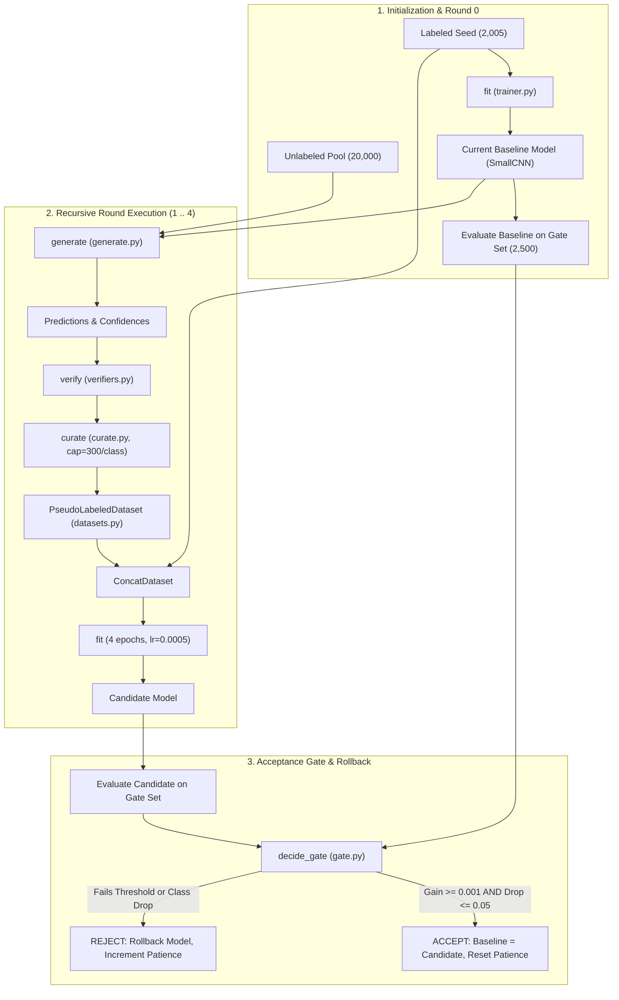

# Recursive Self-Improvement Loop Implementation Guide

This document provides a technical implementation guide for Phase 2 (Recursive Self-Improvement Loop) of the `ai-paradigms-lab`. For the shared foundation (data loaders, tensor acceleration, basic training, and model registry), see [DISTILLATION_IMPLEMENTATION.md](file:///home/natnale/ai-paradigms-lab/docs/DISTILLATION_IMPLEMENTATION.md).

---

## 1. Executive Summary & Data Flow

The recursive self-improvement loop enables a neural network to iteratively bootstrap its accuracy on unlabeled data under strict verification safeguards. The process begins in Round 0 by training an initial seed model on a small, stratified labeled dataset. In each subsequent round, the model generates candidate predictions across an unlabeled pool. A verifier filters these candidates, and a curation mechanism enforces per-class caps to prevent easy-class dominance. The training set is expanded with fixed pseudo-labels, and a cloned candidate model is trained for four epochs. An automated dual-metric acceptance gate evaluates the candidate against the baseline on an unseen gate set; if overall accuracy fails to improve or any single class drops, the candidate is rolled back.



---

## 2. File Tree

```
src/paradigms/
├── models/
│   └── small_cnn.py           # 105k-parameter SmallCNN with 2 conv layers and 2 linear layers
├── recursive/
│   ├── state.py               # Disjoint LoopPartition, LoopBundle, and leakage assertions
│   ├── datasets.py            # PseudoLabeledDataset wrapping base samples with predicted labels
│   ├── generate.py            # Forward batch inference yielding aligned candidate predictions
│   ├── curate.py              # Class-balanced candidate selection under per-class caps
│   ├── verifiers.py           # Verification strategies: Oracle, Agreement, Self-Confidence, None
│   ├── gate.py                # Dual-metric acceptance gate checking overall gain and class drop
│   └── loop.py                # Main bounded recursive execution engine with state rollback
└── reporting/
    └── recursive.py           # Multi-seed result aggregation, carry-forward, and plotting
```

---

## 3. File-by-File Technical Guide

### `src/paradigms/models/small_cnn.py`
- **Purpose**: Compact convolutional neural network used as the generator across all recursive experiments.
- **Main Class**:
  - `src/paradigms/models/small_cnn.py::SmallCNN`: 105,866-parameter network.
- **Architecture**:
  - `Conv2d(1, 16, 3, pad=1)` $\rightarrow$ `ReLU` $\rightarrow$ `MaxPool2d(2)` (14x14)
  - `Conv2d(16, 32, 3, pad=1)` $\rightarrow$ `ReLU` $\rightarrow$ `MaxPool2d(2)` (7x7)
  - `Flatten` (1,568 dims) $\rightarrow$ `Linear(1568, 64)` $\rightarrow$ `ReLU` $\rightarrow$ `Linear(64, 10)`
- **Called By**: `src/paradigms/recursive/loop.py::run_loop`.
- **Tested By**: `tests/test_recursive_blocks.py::test_small_cnn_architecture_and_registry`.

---

### `src/paradigms/recursive/state.py`
- **Purpose**: Partitions training data into disjoint roles, bundles datasets, and asserts strict leakage prevention.
- **Main Classes & Functions**:
  - `src/paradigms/recursive/state.py::LoopPartition`: Immutable dataclass holding `labeled`, `pool`, `gate`, and `monitor` index lists.
  - `src/paradigms/recursive/state.py::make_partition(data: FashionData, n_labeled: int, pool_size: int, seed: int) -> LoopPartition`: Deterministically samples disjoint labeled seed and unlabeled pool.
  - `src/paradigms/recursive/state.py::assert_no_leakage(part: LoopPartition) -> None`: Asserts that labeled, pool, gate, and monitor are pairwise disjoint.
  - `src/paradigms/recursive/state.py::LoopBundle`: Encapsulates datasets, index partitions, and hidden labels.
  - `src/paradigms/recursive/state.py::make_bundle(data: FashionData, rcfg: dict[str, Any] | Any, seed: int) -> LoopBundle`: Builds verified execution bundle.
- **Algorithm (assert_no_leakage)**:
  1. Cast each partition list to a set.
  2. Iterate over all pairwise combinations of partition names.
  3. Compute set intersection: `overlap = set_a & set_b`.
  4. Raise `AssertionError` listing all overlapping index counts if any intersection is non-empty.
- **Inputs & Outputs**: Takes `FashionData` and configuration. Returns `LoopPartition` or `LoopBundle`.
- **Called By**: `src/paradigms/recursive/loop.py::run_loop`.
- **Tested By**: `tests/test_recursive_bookkeeping.py::test_partition_counts_leakage_and_determinism`, `tests/test_recursive_bookkeeping.py::test_assert_no_leakage_raises_on_overlap`.

---

### `src/paradigms/recursive/datasets.py`
- **Purpose**: Dataset wrapper substituting model-predicted pseudo-labels in place of ground-truth labels.
- **Main Class**:
  - `src/paradigms/recursive/datasets.py::PseudoLabeledDataset`: PyTorch `Dataset` indexing into base images with synthetic labels.
- **Algorithm**:
  1. Stores base dataset, sequence of pool indices, and sequence of assigned pseudo-labels.
  2. On `__getitem__(i)`, accesses `base_dataset[indices[i]][0]` to extract the raw image.
  3. Returns `(image, int(labels[i]))`.
- **Inputs & Outputs**: Takes base dataset, sample indices, and label sequence. Yields image-label tuples.
- **Called By**: `src/paradigms/recursive/loop.py::run_loop`.
- **Tested By**: `tests/test_recursive_blocks.py::test_pseudolabeled_dataset`.

---

### `src/paradigms/recursive/generate.py`
- **Purpose**: Executes model inference over pool sample indices to generate predicted classes and confidence scores.
- **Main Classes & Functions**:
  - `src/paradigms/recursive/generate.py::Candidates`: Dataclass holding aligned `indices`, `preds`, and `confs` numpy arrays.
  - `src/paradigms/recursive/generate.py::generate(model: nn.Module, base: Dataset, indices: Sequence[int] | np.ndarray, batch_size: int = 512) -> Candidates`: Runs batched inference on CPU.
- **Algorithm**:
  1. Slices `base` dataset by `indices` and wraps in an in-memory `TensorLoader`.
  2. Evaluates model logits via `src/paradigms/training/evaluate.py::predict_logits`.
  3. Computes softmax probabilities: $p = \text{softmax}(z, \dim=-1)$.
  4. Extracts predicted class $\hat{y} = \arg\max(p)$ and confidence $c = \max(p)$.
- **Inputs & Outputs**: Takes PyTorch model, base dataset, and index list. Returns `Candidates` dataclass.
- **Called By**: `src/paradigms/recursive/loop.py::run_loop`.
- **Tested By**: `tests/test_recursive_bookkeeping.py::test_generate_preserves_order`.

---

### `src/paradigms/recursive/curate.py`
- **Purpose**: Selects verified candidate samples under strict class-wise caps to prevent easy-class dominance.
- **Main Function**:
  - `src/paradigms/recursive/curate.py::curate(indices, preds, confs, verified_mask, cap_per_class: int, seed: int, strategy: str) -> tuple[np.ndarray, np.ndarray]`: Selects up to `cap_per_class` samples per class.
- **Algorithm**:
  1. Filter candidates to verified subset using `verified_mask`.
  2. Group verified indices by predicted class label.
  3. For each class $c$:
     - If count $\le \text{cap}$, retain all samples.
     - If strategy is `"random"`, permute indices with seeded `RandomState` and select first `cap`.
     - If strategy is `"confident"`, sort indices descending by confidence and select top `cap`.
  4. Concatenate and sort selected indices by dataset index for deterministic ordering.
- **Inputs & Outputs**: Takes candidate arrays, boolean verification mask, cap integer, and seed. Returns `(selected_indices, selected_labels)`.
- **Called By**: `src/paradigms/recursive/loop.py::run_loop`.
- **Tested By**: `tests/test_recursive_bookkeeping.py::test_curate_caps_verification_and_strategies`.

---

### `src/paradigms/recursive/verifiers.py`
- **Purpose**: Defines candidate verification mechanisms under strict structural isolation.
- **Main Classes & Functions**:
  - `src/paradigms/recursive/verifiers.py::Verifier`: Abstract base class defining `fit` and `verify`.
  - `src/paradigms/recursive/verifiers.py::OracleVerifier`: Perfect verifier accepting $\hat{y} == y^*_{\text{hidden}}$ (ceiling benchmark).
  - `src/paradigms/recursive/verifiers.py::AgreementVerifier`: Independent Random Forest ensemble (200 trees) trained solely on labeled seed.
  - `src/paradigms/recursive/verifiers.py::SelfConfidenceVerifier`: Model grading itself via softmax score $\ge 0.90$.
  - `src/paradigms/recursive/verifiers.py::NoVerifier`: Rejects all candidates (compute control).
  - `src/paradigms/recursive/verifiers.py::build_verifier(name: str, rcfg, bundle: LoopBundle, seed: int) -> Verifier`: Factory enforcing structural label isolation.
- **Structural Enforcement**:
  Only `OracleVerifier` receives `bundle.hidden_labels`. All other verifiers are passed image pixels and labeled targets, with zero access to hidden pool labels.
- **Called By**: `src/paradigms/recursive/loop.py::run_loop`.
- **Tested By**: `tests/test_verifiers.py::test_oracle_verifier`, `tests/test_verifiers.py::test_agreement_verifier_precision_on_separable_data`, `tests/test_verifiers.py::test_non_oracle_verifiers_immune_to_shuffled_hidden_labels`.

---

### `src/paradigms/recursive/gate.py`
- **Purpose**: Decides whether candidate model improvements are accepted or rolled back.
- **Main Function**:
  - `src/paradigms/recursive/gate.py::decide_gate(candidate: dict[str, Any], baseline: dict[str, Any], gate_cfg: dict[str, Any]) -> tuple[bool, str]`: Evaluates dual-metric acceptance criteria on gate set.
- **Algorithm**:
  1. Compute overall accuracy gain: $\Delta = \text{acc}_{\text{cand}} - \text{acc}_{\text{base}}$.
  2. If $\Delta < \text{min\_improvement}$ ($0.001$), reject: `"rejected: gain below threshold"`.
  3. For every class $c \in \{0..9\}$:
     - Compute drop: $\text{drop} = \text{acc}_{\text{base}}[c] - \text{acc}_{\text{cand}}[c]$.
     - If $\text{drop} > \text{max\_class\_drop}$ ($0.05$), reject: `"rejected: class c dropped"`.
  4. If both checks pass, return `(True, "accepted")`.
- **Called By**: `src/paradigms/recursive/loop.py::run_loop`.
- **Tested By**: `tests/test_recursive_loop.py::test_decide_gate_cases`.

---

### `src/paradigms/recursive/loop.py`
- **Purpose**: Executes the bounded multi-round recursive self-improvement loop with state rollback.
- **Main Function**:
  - `src/paradigms/recursive/loop.py::run_loop(cfg, bundle: LoopBundle, seed: int, verifier_name: str, gate_enabled: bool, ckpt_dir: str | Path | None, verbose: bool) -> dict[str, Any]`: Top-level loop runner.
- **Algorithm**:
  1. Train initial Round 0 model on `labeled_ds` (30 epochs, lr 0.001) and evaluate on gate and monitor sets.
  2. Instantiate and fit verifier on labeled data.
  3. For each round $r \in \{1..\text{rounds}\}$:
     - Generate predictions over pool: `generate`.
     - Filter predictions: `verifier.verify`.
     - Curate under per-class caps: `curate`.
     - Concatenate fixed pseudo-labels to labeled seed.
     - Clone current model and train candidate (4 epochs, lr 0.0005).
     - Evaluate candidate on gate and monitor sets.
     - Decide acceptance: `decide_gate`.
     - If accepted: candidate becomes baseline, pool samples removed, rejections reset to 0.
     - If rejected: candidate discarded, rejections incremented. If rejections $\ge$ patience (2), stop early.
  4. Save final checkpoint and return full round execution log.
- **Called By**: `scripts/run_recursive.py`, `scripts/run_recursive_experiments.py`.
- **Tested By**: `tests/test_recursive_loop.py::test_oracle_loop_precision`, `tests/test_recursive_loop.py::test_rollback_on_impossible_gate`.

---

## 4. Script Walkthroughs & Call Chains

### Script 1: `scripts/run_recursive.py`
- **Execution**: `python scripts/run_recursive.py --verifier oracle --seed 0`
- **Call Chain**:
  `scripts/run_recursive.py::main` $\rightarrow$ `src/paradigms/recursive/state.py::make_bundle` $\rightarrow$ `src/paradigms/recursive/loop.py::run_loop` $\rightarrow$ `src/paradigms/recursive/gate.py::decide_gate`
- **Files Read**: `configs/base.yaml`, `configs/recursive.yaml`, `data/splits/`
- **Files Written**: `experiments/recursive/{tag}/seed0.json`, `checkpoints/recursive/{tag}/seed0/{round0,final}.pt`

### Script 2: `scripts/make_recursive_report.py`
- **Execution**: `python scripts/make_recursive_report.py`
- **Call Chain**:
  `scripts/make_recursive_report.py::main` $\rightarrow$ `src/paradigms/reporting/recursive.py::load_recursive_results` $\rightarrow$ `src/paradigms/reporting/recursive.py::compute_recursive_summary` $\rightarrow$ `src/paradigms/reporting/recursive.py::compute_round_progression` $\rightarrow$ plotting functions
- **Files Read**: `experiments/recursive/*/seed*.json`
- **Files Written**: `reports/recursive/tables/rec_summary.{md,csv}`, `rec_rounds.{md,csv}`, `rec_findings.md`, `reports/recursive/figures/fig_rec_*.png`

---

## 5. Result File Schemas

### Schema: `experiments/recursive/{config}/seed{seed}.json`
- `log`: List of per-round execution dictionaries (rounds 0..N).
  - `round`: Integer round index ($0, 1, 2, 3, 4$).
  - `accepted`: Boolean indicating whether round candidate was accepted by gate.
  - `reason`: String status (`"initial"`, `"accepted"`, or rejection reason).
  - `n_candidates`: Total candidate pool size evaluated in round.
  - `n_verified`: Count of candidates passing verification.
  - `n_selected`: Count of candidates retained after per-class curation caps.
  - `selected_precision`: Ground-truth accuracy of selected pseudo-labels (diagnostic only).
  - `train_size`: Total training dataset size in round ($N_L + N_{\text{pseudo}}$).
  - `cand_gate_acc`: Candidate accuracy on gate set.
  - `cand_monitor_acc`: Candidate accuracy on monitor set.
  - `current_gate_acc`: Active baseline model accuracy on gate set.
  - `current_monitor_acc`: Active baseline model accuracy on monitor set.
  - `current_min_class_acc`: Minimum per-class accuracy across all 10 classes on gate set.
  - `current_worst_class`: Integer index of worst-performing class.
  - `label_noise_in_training`: Cumulative fraction of incorrect pseudo-labels in training set.
  - `seconds`: Wall-clock execution time for the round in seconds.
- `stop_reason`: Termination cause string (`"completed"`, `"patience"`, or `"pool_empty"`).
- `round0_gate_acc`: Gate set accuracy of initial seed model.
- `round0_monitor_acc`: Monitor set accuracy of initial seed model.
- `round0_per_class`: List of 10 float per-class accuracies for Round 0 model.
- `final_monitor_acc`: Monitor set accuracy of final accepted model.
- `final_per_class`: List of 10 float per-class accuracies for final model.
- `n_accepted_rounds`: Count of successfully accepted rounds.
- `n_rejected_rounds`: Count of candidate rejections.
- `n_pseudo_labels_total`: Cumulative count of pseudo-labels incorporated into final model.
- `total_verifier_calls`: Total candidate evaluations performed by verifier.
- `total_seconds`: Total execution duration in seconds.
- `verifier`: Name of verifier used (`"oracle"`, `"agreement"`, `"self_conf"`, `"none"`).
- `gate_enabled`: Boolean flag indicating whether acceptance gate was active.
- `seed`: Execution random seed.

---

## 6. Design Decisions & Rationale

1. **Disjoint Gate and Monitor Partitions**: The 10,000-sample dev set was split into a 4,997-sample `gate` set and a 5,003-sample `monitor` set (`src/paradigms/data/splits.py::split_dev`). The gate set is used strictly for accept/reject decisions. The monitor set is never read by any decision logic, serving as an unbiased holdout that measures whether the model overfits the gate.
2. **Monotonic Fixed Dataset Expansion**: Once a candidate is accepted, its pseudo-labels are fixed and locked into training (`src/paradigms/recursive/datasets.py::PseudoLabeledDataset`). Dynamically re-predicting labels every round allows cyclic flip-flops where the model oscillates between confused categories. Fixed expansion anchors the feature space against catastrophic forgetting.
3. **Structural Isolation of Hidden Labels**: Only `OracleVerifier` takes `hidden_labels` in its constructor. All other verifiers are instantiated without access to ground truth. This prevents unintentional data leakage and ensures empirical legitimacy.

---

## 7. How to Extend the Recursive Loop

### Example 1: Latent Feature Space Agreement Verifier
Instead of training a Random Forest on flat 784-dimensional raw pixels:
1. In `src/paradigms/models/small_cnn.py::SmallCNN`, add an `extract_features(x)` method returning the 64-dimensional output of `fc1`.
2. In `src/paradigms/recursive/verifiers.py`, create `EmbeddingAgreementVerifier`.
3. In `fit()`, extract CNN embeddings for the 2,005 labeled samples and fit a Support Vector Machine (`sklearn.svm.SVC`).
4. In `verify()`, accept candidates where the SVM prediction on candidate embeddings matches the CNN's output.

### Example 2: Adaptive Class-Wise Drop Tolerances
Instead of a fixed 5% drop limit:
1. In `src/paradigms/recursive/gate.py::decide_gate`, accept an optional `class_weights` vector.
2. Compute dynamic thresholds: $\text{drop\_limit}[c] = 0.05 \times (1.0 + \sigma_c)$, giving higher tolerance to inherently noisy classes like Coats and Shirts.

### Example 3: Adding an Active Learning Uncertainty Sampler
1. In `src/paradigms/recursive/curate.py`, add `strategy="uncertainty"`.
2. Compute entropy: $H(p) = -\sum_c p_c \log p_c$.
3. Select samples with highest entropy to request human oracle labels in human-in-the-loop workflows.

---

## Glossary of Terms
- **Pseudo-Label**: A model-generated prediction assigned to an unlabeled sample and treated as ground truth during subsequent training rounds.
- **Confirmation Bias**: The tendency of a self-training model to reinforce its own incorrect high-confidence predictions, compounding noise over successive rounds.
- **Rollback**: Restoring model weights to the previous checkpoint when a candidate fails validation acceptance checks.
- **Acceptance Gate**: A decision module that guards dataset expansion by requiring measurable out-of-sample accuracy gain and restricting per-class degradation.
- **Monitor Set**: A passive holdout partition used exclusively for diagnostic evaluation and never read by any operational decision logic.
