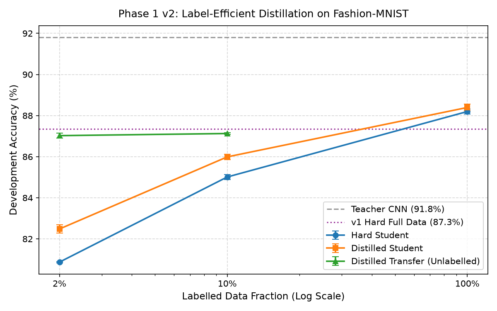
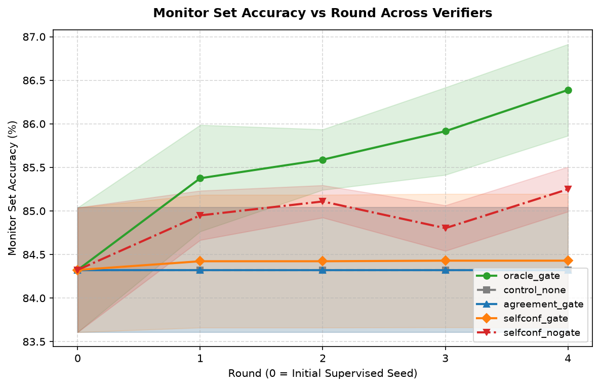

# Experimental Results & Consolidated Findings

This document consolidates all empirical measurements across Phase 1 (Knowledge Distillation v1 and v2) and Phase 2 (Recursive Self-Improvement Loop) of the `ai-paradigms-lab`. All values are extracted directly from serialized JSON and markdown artifacts.

---

## 1. Data Splits & Partition Manifest

Dataset: `FashionMNIST` (source: `torchvision.datasets.FashionMNIST`, `split_seed=42`).

| Partition Name | Sample Count | Scope / Role | SHA-256 Index Hash |
| :--- | :--- | :--- | :--- |
| `train` | 50,000 | Supervised training base | `2aa19d8c872458d0...71b30c58` |
| `dev` | 10,000 | Model selection & hyperparameter tuning | `21d3012417c9b2fc...a7d481e6` |
| `gate` | 4,997 | Phase 2 candidate acceptance decisions (within dev) | `cf6ae10381946b94...812dfb94` |
| `monitor` | 5,003 | Phase 2 passive generalization tracking (within dev) | `287f908038d45c77...b9e69b87` |
| `test` | 10,000 | Official protected test evaluation (one-shot) | `a74675bfed3834ac...b2075ff4` |

### Phase 2 Partitions (Per Seed)

| Execution Seed | Initial Labeled Count | Labeled SHA-256 | Unlabeled Pool Count | Pool SHA-256 |
| :--- | :--- | :--- | :--- | :--- |
| `seed0` | 2,005 | `ddafb45ebfa0ec84...` | 20,000 | `b94cb7f311073b85...` |
| `seed1` | 2,005 | `2dfe43846ecc6f5f...` | 20,000 | `4a0e14dae4ccf987...` |
| `seed2` | 2,005 | `a3a6a2b346eb5a87...` | 20,000 | `d9a759ae3ae51022...` |
---

## 2. Distillation: v1 Baseline vs v2 Label-Efficient Study

### Phase 1 v1 Main Comparison (Dev Set, Full 50k Data Regime)
*Reference file: `reports/tables/phase1_main.md` and `reports/tables/phase1_paired.md` (8 epochs, T=4.0, alpha=0.5)*

| Model | Architecture | Parameters | Dev Accuracy (Mean ± Std) | Paired Gain vs Hard | Wins / 5 Seeds |
| :--- | :--- | :--- | :--- | :--- | :--- |
| **Teacher (CNN)** *(Reference)* | CNN (2 conv + 2 linear) | 421,642 | 91.82% ± 0.23% | — | — |
| **Hard Student (MLP)** | MLP (hidden=32) | 25,450 | 87.34% ± 0.21% | baseline | — |
| **Distilled Student (MLP)** | MLP (hidden=32) | 25,450 | 86.85% ± 0.12% | -0.49% ± 0.13% | 0 / 5 |

*Note on v1 failure*: Under the naive 8-epoch protocol without independent tuning, the hard student matched or outperformed the distilled student due to under-training and sub-optimal temperature choice ($T=4$ vs optimal $T=1$).

### Phase 1 v2 Label-Efficient Study Results
*Reference file: `experiments/v2/final/summary.json` (Independent coordinate descent tuning, matched budgets, 5 fresh seeds)*

| Label Fraction | Labeled Samples | Mode | Tuned Hyperparameters | Dev Accuracy (Mean ± Std) | Paired Gain vs Hard | Wins / Seeds | Verdict vs Hard |
| :--- | :--- | :--- | :--- | :--- | :--- | :--- | :--- |
| **2% (`f0.02`)** | 1,000 | Teacher *(Ref)* | default | 91.82% ± 0.23% | — | — | — |
| | | Hard Student | `wd=0.001, ep=400` | 80.87% ± 0.03% | baseline | — | — |
| | | Distilled Student | `T=4.0, a=0.2, wd=0.001, ep=400` | 82.48% ± 0.21% | **+1.61% ± 0.19%** | 5 / 5 | **WIN** |
| | | Distilled Transfer | `T=4.0, a=0.8, wd=0.001, ep=30` | 87.02% ± 0.11% | **+6.15% ± 0.11%** | 5 / 5 | **WIN** |
| **10% (`f0.10`)** | 5,000 | Teacher *(Ref)* | default | 91.82% ± 0.23% | — | — | — |
| | | Hard Student | `wd=0.001, ep=300` | 85.01% ± 0.12% | baseline | — | — |
| | | Distilled Student | `T=4.0, a=0.5, wd=0.001, ep=300` | 85.99% ± 0.13% | **+0.98% ± 0.22%** | 5 / 5 | **WIN** |
| | | Distilled Transfer | `T=4.0, a=0.2, wd=0.001, ep=30` | 87.13% ± 0.05% | **+2.11% ± 0.14%** | 5 / 5 | **WIN** |
| **100% (`f1.0`)** | 50,000 | Teacher *(Ref)* | default | 91.82% ± 0.23% | — | — | — |
| | | Hard Student | `wd=0.0001, ep=30` | 88.20% ± 0.12% | baseline | — | — |
| | | Distilled Student | `T=1.0, a=0.5, wd=0.0001, ep=30` | 88.39% ± 0.16% | **+0.20% ± 0.17%** | 4 / 5 | **WIN** |
---

## 3. Phase 2: Recursive Self-Improvement Loop

*Reference file: `reports/recursive/tables/rec_summary.md` and `rec_findings.md` (Seeds 0, 1, 2, SmallCNN, 4 rounds)*

| Config          | Round-0 Monitor Acc | Final Monitor Acc | Paired Gain vs R0    | Paired Gain vs control_none | Accepted Rounds | Rejected Rounds | Total Pseudo-Labels | Mean Precision  | Final Label Noise (%) | Worst-Class Δ vs R0 | Total Verifier Calls | Total Seconds |
| --------------- | ------------------- | ----------------- | -------------------- | --------------------------- | --------------- | --------------- | ------------------- | --------------- | --------------------- | ------------------- | -------------------- | ------------- |
| oracle_gate     | 84.32% ± 0.72%      | 86.39% ± 0.53%    | +2.07% ± 1.17% (3/3) | +2.07% ± 1.17% (3/3)        | 2.7 ± 0.5       | 1.3 ± 0.5       | 8,000               | 1.0000 ± 0.0000 | 0.00% ± 0.00%         | -4.58% ± 1.45%      | 70,000               | 55.7s ± 2.1s  |
| agreement_gate  | 84.32% ± 0.72%      | 84.32% ± 0.72%    | +0.00% ± 0.00% (0/3) | +0.00% ± 0.00% (0/3)        | 0.0 ± 0.0       | 2.0 ± 0.0       | 0                   | 0.9516 ± 0.0060 | 0.00% ± 0.00%         | -3.42% ± 1.67%      | 40,000               | 31.5s ± 2.6s  |
| selfconf_gate   | 84.32% ± 0.72%      | 84.43% ± 0.77%    | +0.11% ± 0.15% (1/3) | +0.11% ± 0.15% (1/3)        | 0.7 ± 0.9       | 2.0 ± 0.0       | 1,945               | 0.9309 ± 0.0111 | 2.17% ± 3.07%         | -4.89% ± 1.51%      | 49,498               | 32.4s ± 10.5s |
| selfconf_nogate | 84.32% ± 0.72%      | 85.25% ± 0.26%    | +0.93% ± 0.59% (3/3) | +0.93% ± 0.59% (3/3)        | 4.0 ± 0.0       | 0.0 ± 0.0       | 11,761              | 0.9133 ± 0.0206 | 8.66% ± 0.26%         | -11.36% ± 5.84%     | 62,253               | 61.8s ± 3.2s  |
| control_none    | 84.32% ± 0.72%      | 84.32% ± 0.72%    | +0.00% ± 0.00% (0/3) | baseline                    | 0.0 ± 0.0       | 2.0 ± 0.0       | 0                   | N/A             | 0.00% ± 0.00%         | -3.42% ± 1.67%      | 40,000               | 21.8s ± 0.8s  |

### Fixed-Rule Verdicts vs `control_none`
- **`oracle_gate`**: Paired diff = `+2.07% ± 1.17%`, wins = `3/3` $\rightarrow$ **WIN**
- **`agreement_gate`**: Paired diff = `+0.00% ± 0.00%`, wins = `0/3` $\rightarrow$ **TIE**
- **`selfconf_gate`**: Paired diff = `+0.11% ± 0.15%`, wins = `1/3` $\rightarrow$ **TIE**
- **`selfconf_nogate`**: Paired diff = `+0.93% ± 0.59%`, wins = `3/3` $\rightarrow$ **WIN** (accompanied by -11.36% worst-class collapse)
- **`control_none`**: baseline $\rightarrow$ **TIE**
---

## 4. Protected Official Test Set Evaluations

Official test evaluation executed strictly one-shot on frozen checkpoints via dedicated scripts.

### Phase 1 v1 Test Results (`experiments/final/phase1_test.json`)
*Commit: `d122df0cb9fe`*

| Model | Parameters | Test Accuracy (Mean ± Std) | Paired Gain vs Hard |
| :--- | :--- | :--- | :--- |
| Teacher (CNN) | 421,642 | 91.35% ± 0.19% | — |
| Hard Student (MLP) | 25,450 | 86.45% ± 0.06% | baseline |
| Distilled Student (MLP) | 25,450 | 86.64% ± 0.25% | +0.20% ± 0.27% (4/5) |

### Phase 1 v2 Label-Efficient Test Results
| Phase 1 v2 Label-Efficient Test | NOT RUN | NOT RUN | NOT RUN |

*Status: NOT RUN. Official test evaluation for Phase 1 v2 was never authorized or executed.*

### Phase 2 Recursive Loop Test Results (`experiments/final/recursive_test.json`)
*Commit: `70ab55b784b5`*

| Configuration | Round 0 Test Acc (Mean ± Std) | Final Test Acc (Mean ± Std) | Paired Gain (Final - R0) | Wins / Seeds |
| :--- | :--- | :--- | :--- | :--- |
| `oracle_gate` | 83.89% ± 0.83% | 86.08% ± 0.26% | +2.19% ± 1.07% | 3/3 |
| `agreement_gate` | 83.89% ± 0.83% | 83.89% ± 0.83% | +0.00% ± 0.00% | 0/3 |
| `selfconf_gate` | 83.89% ± 0.83% | 83.97% ± 0.90% | +0.08% ± 0.12% | 1/3 |
| `selfconf_nogate` | 83.89% ± 0.83% | 84.97% ± 0.32% | +1.08% ± 0.54% | 3/3 |
| `control_none` | 83.89% ± 0.83% | 83.89% ± 0.83% | +0.00% ± 0.00% | 0/3 |
---

## 5. Visualizations & Figures

### Figure 1: Knowledge Distillation Across Label Regimes (Phase 1 v2)

*Caption: Dev set accuracy across 2%, 10%, and 100% label regimes comparing Hard Student, Distilled Student, Distilled Transfer, and Teacher. Note the massive +6.15% gain of Distilled Transfer at 2% data and the diminishing return (+0.20%) at 100% data.*

### Figure 2: Recursive Loop Monitor Accuracy vs Round (Phase 2)

*Caption: Monitor set accuracy progression over rounds 0 to 4 across all 5 recursive loop configurations (with early-stop carry-forward). Look at the steady climb of oracle_gate (+2.07%), the flat line of control_none and agreement_gate, and the plateau of selfconf_nogate.*
